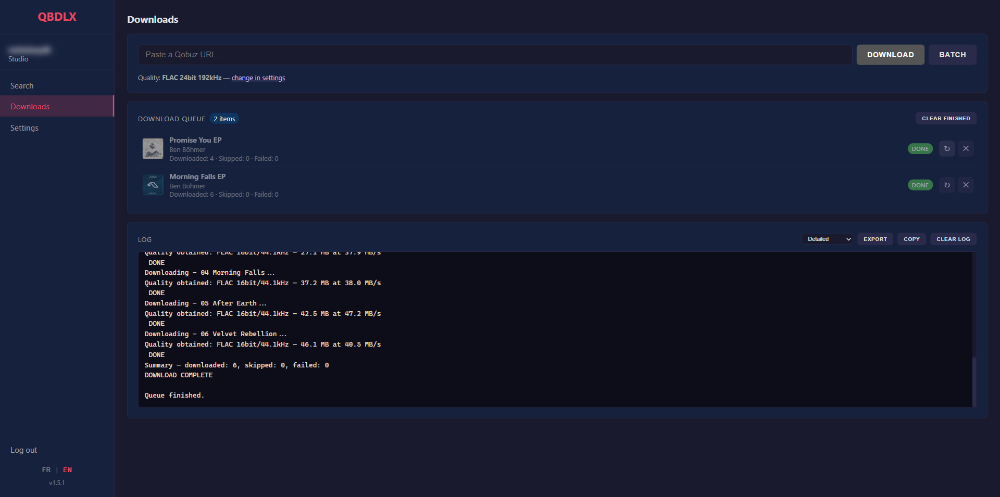
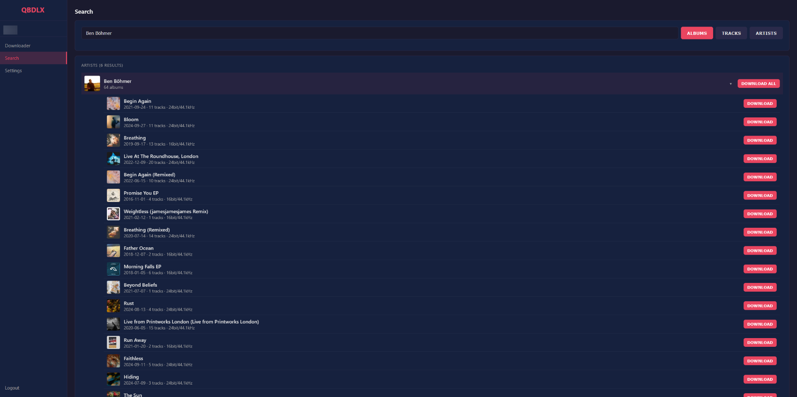
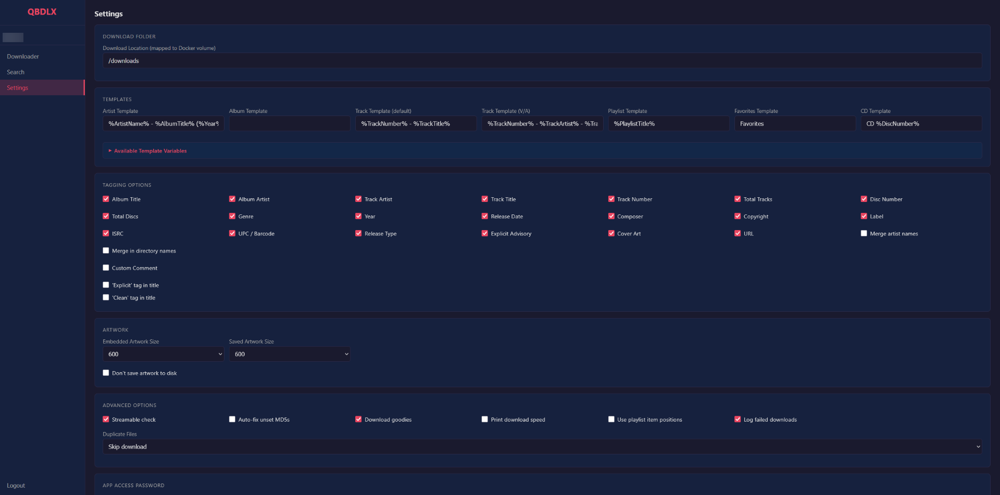

# QobuzDLX.Web

A self-hosted web application for downloading high-quality music from Qobuz. Built with Blazor Server (.NET 8) and designed to run in Docker.


---

## Features

- **Web-based UI** — Dark theme, responsive, accessible from any browser
- **Multiple download types** — Albums, tracks, playlists, artists, labels, favorites
- **Bilingual UI** — French and English, one-click switch, browser language detected on first run
- **Search** — Search Qobuz by albums, tracks, artists or playlists directly from the UI, with sorting by
  title, artist, release date, quality or track count, a Hi-Res only filter, and a "Show more"
  button to go past the first 50 results
- **Batch downloads** — Paste multiple URLs and download them all at once
- **4 quality levels** — MP3 320, FLAC 16-bit, FLAC 24-bit (up to 96kHz), FLAC 24-bit (up to 192kHz)
- **Full metadata tagging** — ID3v2.4 (MP3) and Vorbis Comments (FLAC) with 25+ configurable tags
- **Customizable file/folder naming** — 60+ template variables for artist, album, track naming
- **Artwork** — Embedded cover art + saved to disk, configurable sizes
- **Goodies** — Downloads bonus materials (booklets, etc.) when available
- **FLAC MD5 fix** — Optional automatic MD5 checksum repair
- **Real-time progress** — Live progress bar, download speed, and log output
- **Download report** — Each queue entry shows how many tracks were downloaded, skipped or failed,
  lists the failures with their reason, and can retry just those tracks
- **Persistent settings** — All configuration saved to JSON, survives restarts
- **Docker-ready** — Multi-stage Alpine image, lightweight and portable

---

## Screenshots

| Downloader | Search | Settings |
|:---:|:---:|:---:|
|  |  |  |

---

## Quick Start (Docker)

### Using Docker Run

```bash
docker run -d \
  --name qobuzdlx \
  -p 8080:8080 \
  -v /path/to/downloads:/downloads \
  -v /path/to/config:/config \
  --restart unless-stopped \
  thimble9057/qobuzdlx.web
```

### Using Docker Compose

Create a `docker-compose.yml`:

```yaml
services:
  qobuzdlx:
    image: thimble9057/qobuzdlx.web
    container_name: qobuzdlx
    ports:
      - "8080:8080"
    volumes:
      - /path/to/downloads:/downloads
      - /path/to/config:/config
    restart: unless-stopped
```

Then run:

```bash
docker-compose up -d
```

Open your browser at **http://localhost:8080**

---

## Volumes

| Path | Description |
|------|-------------|
| `/downloads` | Where downloaded music files are saved |
| `/config` | Persistent configuration (`settings.json`, plus its `.bak` backup) |

### File permissions

The container runs as a non-root user `qbdlx` with **UID 1000** and **GID 1000**. You must set the correct ownership on your mounted volumes so the container can read and write to them:

```bash
chown -R 1000:1000 /path/to/downloads /path/to/config
```

---

## Security

> **QobuzDLX.Web has no access control until you set a password.** By default anyone who can reach
> the port uses *your* Qobuz account, can read the settings and can start downloads. Do not expose
> it to the internet in that state.

- **Set an access password** in *Settings* as soon as the app is reachable by anyone but you. A
  warning banner stays visible until you do, and the server logs a warning at startup.
- **Put it behind a reverse proxy with HTTPS** if it is reachable from outside your network. The
  password and the unlock cookie otherwise travel in clear text.
- **Behind an HTTPS reverse proxy, set `COOKIE_SECURE=true`.** The container only sees plain HTTP,
  so it cannot tell on its own that the unlock cookie should carry the `Secure` flag. Do not set it
  if you also reach the app over plain `http://` (directly on your LAN, or from the Android app):
  browsers refuse `Secure` cookies over HTTP and the unlock would never stick.

  ```yaml
  environment:
    - COOKIE_SECURE=true
  ```
- `settings.json` holds your Qobuz session token and app secret in clear text: keep `/config`
  readable by the container user only.

---

## Configuration

### Login

On first launch, you'll be redirected to the login page. You can authenticate with:

- **Email + Password** — Your Qobuz account credentials
- **Token** — Use an existing user auth token

The app automatically retrieves the required `app_id` and `app_secret` from Qobuz. You can also provide custom values if needed.

### Quality

Select your preferred audio quality from the settings page:

| Option | Format | Quality ID |
|--------|--------|------------|
| MP3 320 | `.mp3` | 5 |
| FLAC 16-bit | `.flac` | 6 |
| FLAC 24-bit ≤96kHz | `.flac` | 7 |
| FLAC 24-bit 192kHz | `.flac` | 27 |

If a track is not available in the chosen FLAC quality, lower FLAC qualities are tried in turn.
MP3 is never used as a fallback for FLAC, so a `.flac` file always contains FLAC audio.

### Templates

Customize your folder and file structure using template variables. Default structure:

```
/downloads/{ArtistName}/{AlbumTitle}/{TrackNumber} - {TrackTitle}.flac
```

Available templates:

| Template | Default | Description |
|----------|---------|-------------|
| Artist | `%ArtistName%` | Artist folder name |
| Album | `%AlbumTitle%` | Album folder name |
| Track | `%TrackNumber% - %TrackTitle%` | Track filename |
| VA Track | `%TrackNumber% - %TrackArtist% - %TrackTitle%` | Track filename for compilations |
| Playlist | `%PlaylistTitle%` | Playlist folder name |
| Favorites | `Favorites` | Favorites folder name |
| CD | `CD %DiscNumber%` | Multi-disc subfolder |

The Settings page previews the resulting path for an album track, a compilation track and a
playlist track as you edit the templates, and warns about an empty track template, unknown or
misplaced `%tags%`, templates starting with `/` or containing `..`, and characters that will be
replaced in names (`\ : * ? " < > |`; only `/` separates folders).

<details>
<summary><strong>All template variables</strong></summary>

**Release-specific:**
`%AlbumID%`, `%AlbumURL%`, `%AlbumTitle%`, `%AlbumGenre%`, `%AlbumComposer%`, `%Label%`, `%Copyright%`, `%UPC%`, `%ReleaseDate%`, `%Year%`, `%ReleaseType%`, `%ArtistName%`, `%Format%`, `%FormatWithQuality%`, `%FormatWithHiResQuality%`, `%BitDepth%`, `%SampleRate%`

**Track-specific:**
`%TrackID%`, `%TrackNumber%`, `%TrackTitle%`, `%TrackArtist%`, `%TrackComposer%`, `%ISRC%`, `%TrackFormat%`, `%TrackFormatWithQuality%`, `%TrackFormatWithHiResQuality%`, `%TrackBitDepth%`, `%TrackSampleRate%`

**Playlist-specific:**
`%PlaylistID%`, `%PlaylistTitle%`

**Disc-specific:**
`%DiscNumber%` *(multi-disc folder and track templates; empty in album and playlist folder templates)*

**Parental advisory:**
`%TrackPA%`, `%TrackPAShort%`, `%TrackPAifEx%`, `%TrackPAEnclosed%`, `%AlbumPA%`, `%AlbumPAShort%`, `%AlbumPAifEx%`, `%AlbumPAEnclosed%` *(and more variants)*

</details>

### Tagging

Toggle individual metadata tags from the Settings page:

Album, Album Artist, Artist, Title, Track Number, Total Tracks, Disc Number, Total Discs, Genre, Year, Release Date, Composer, Copyright, Label, ISRC, UPC, Type, Explicit, Cover Art, URL, Custom Comment

Additional tagging options:
- Merge multiple artist names
- Add Explicit/Clean tags to track titles
- Custom comment text with `%description%` placeholder

### Artwork

| Setting | Default | Description |
|---------|---------|-------------|
| Embedded art size | 600px | Size of cover art embedded in audio files (50 to 600 px, or the original) |
| Saved art size | 600px | Size of `cover.jpg` saved to disk (50 to 600 px, or the original) |
| Save to disk | Enabled | Save a separate `cover.jpg` file |

### Advanced

| Setting | Default | Description |
|---------|---------|-------------|
| Streamable check | Enabled | Skip non-streamable tracks |
| Fix MD5s | Disabled | Repair FLAC MD5 checksums (requires `flac` CLI) |
| Playlist file | Enabled | Write a `.m3u8` playlist (relative paths, playlist order) next to the downloaded tracks of a playlist |
| Verify integrity | Enabled | Decode every downloaded FLAC with `flac -t`; a damaged file is downloaded again (requires `flac` CLI, about a second per track, skipped when `flac` is missing) |
| Download goodies | Enabled | Download booklets and bonus materials |
| Print speed | Disabled | Show download speed in logs |
| Duplicate handling | Skip | `skip`, `rename`, or `overwrite` existing files |
| Log failed downloads | Enabled | Log errors to output |

---

## Supported URL Types

| Type | URL Pattern | Action |
|------|-------------|--------|
| Album | `https://play.qobuz.com/album/{id}` | Downloads all tracks |
| Track | `https://play.qobuz.com/track/{id}` | Downloads single track |
| Playlist | `https://play.qobuz.com/playlist/{id}` | Downloads all playlist tracks |
| Artist | `https://play.qobuz.com/artist/{id}` | Downloads full discography |
| Label | `https://play.qobuz.com/label/{id}` | Downloads all label releases |
| Favorites | `https://play.qobuz.com/user/{id}/albums` | Downloads favorite albums |
| Favorites | `https://play.qobuz.com/user/{id}/tracks` | Downloads favorite tracks |
| Favorites | `https://play.qobuz.com/user/{id}/artists` | Downloads favorite artists |

Qobuz store links (e.g. `https://www.qobuz.com/fr-fr/album/...`) are also supported and automatically converted.

---

## Build from Source

### Prerequisites

- [.NET 8 SDK](https://dotnet.microsoft.com/download/dotnet/8.0)

### Run locally

```bash
cd QobuzDLX.Web
dotnet run
```

The app will be available at `http://localhost:8080`.

### Build Docker image

```bash
cd QobuzDLX.Web
docker build -t thimble9057/qobuzdlx.web .
```

---

## Tech Stack

| Component | Technology |
|-----------|------------|
| Framework | Blazor Server (.NET 8) |
| Runtime | ASP.NET Core Kestrel |
| Audio tagging | TagLibSharp 2.3.0 |
| JSON | Newtonsoft.Json 13.0.3 |
| Container | Alpine Linux (multi-stage build) |
| FLAC tools | `flac` CLI (installed in container) |

---

## Project Structure

```
QobuzDLX.Web/
├── Pages/
│   ├── Login.razor          # Authentication page
│   ├── Downloader.razor     # Main download page (index)
│   ├── Search.razor         # Search albums, tracks, artists
│   └── Settings.razor       # All configuration options
├── Shared/
│   └── MainLayout.razor     # Sidebar + layout shell
├── Models/
│   ├── AppSettings.cs       # Settings model (60+ properties)
│   └── QobuzModels.cs       # Qobuz API response models
├── Services/
│   ├── QobuzApiService.cs   # Qobuz API client
│   ├── DownloadService.cs   # Core download engine
│   ├── SettingsService.cs   # Persistent JSON settings
│   ├── TemplateService.cs   # Path/filename templating
│   └── TaggingService.cs    # ID3v2 & Vorbis tagging
├── wwwroot/css/app.css      # Dark theme styles
├── Program.cs               # App entry point
├── Dockerfile               # Multi-stage Docker build
└── docker-compose.yml       # Compose configuration
```

---

## Requirements

- A valid **Qobuz account** (subscription required for Hi-Res streaming). Without an active
  subscription, or for restricted tracks, Qobuz only provides a 30-second preview: it is detected
  and the track is skipped with an explanatory message instead of being saved as a full track.
- Docker (recommended) or .NET 8 runtime

---

## Disclaimer

This project is for personal and educational use only. Respect the terms of service of Qobuz and the copyright of artists. Support artists by purchasing their music.
