# QobuzDLX

A self-hosted web application that searches Qobuz and downloads what your subscription gives you into a tidy, tagged library. One small Rust executable with its interface inside, made to run in a container on a NAS or a home server.

[](LICENSE)
[](https://github.com/L-at-nnes/qobuzdlx.web/actions/workflows/docker.yml)

<p align="center">
  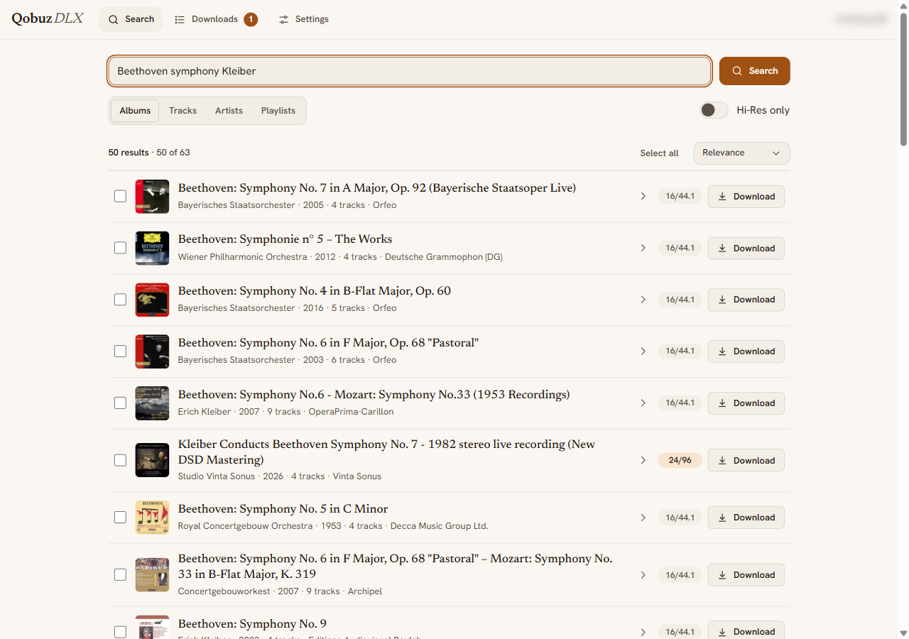
</p>

> Qobuz is a trademark of its owner. This project is not affiliated with Qobuz. It downloads what an active subscription is entitled to: use it for your own library and respect the terms of the service.

## Where it comes from

QobuzDLX started as a fork of [thimble9057's `qobuzdlx.web`](https://gitlab.com/thimble9057/qobuzdlx.web), a Blazor Server application, and this is a rewrite of it in Rust with a new interface. The behaviour, the naming variables and many of the lessons learned (how the Qobuz API really answers, what the CDN does to a download) come from that project and from the desktop program it was itself inspired by, and the rewrite follows them closely. It is an adaptation, not an independent invention: thimble9057 is credited in the [license](LICENSE) next to my own name, and the .NET version is the first part of this repository's history, up to the commit "fix(ui): version the stylesheet URL so an update is not shown with the old CSS".

I rewrote it because I was not happy with the interface or with the language it was written in for a tool like this one, and I wanted something lighter, more powerful and nicer to use.

## Features

- **Search** albums, tracks, artists and playlists; sort by title, artist, date, quality, track count, label or duration; keep only Hi-Res; open an album or a playlist to read its tracks (discs, durations, artists), tick only the ones you want and download just those.
- **Select like in a file explorer**: shift-click takes every row from the last click to this one, ctrl-click adds or removes a row, in the results as well as in the tracks of an album or a playlist.
- **Download** albums, single tracks, playlists, whole discographies, labels and the favourites of the account, in MP3 320, FLAC 16-bit, FLAC up to 24-bit 96 kHz or FLAC up to 24-bit 192 kHz. FLAC never falls back to MP3, and the log tells the quality that was really served.
- **A queue that runs unattended.** It survives a restart: what was waiting resumes, files already on disk are recognised, and the saved Qobuz session is opened again. Reorder, skip an album, cancel an item, retry only the tracks that failed.
- **Made for large libraries.** Several tracks of an album download at once (1 to 6, 3 by default): Qobuz serves each file at a modest speed, so this is what turns weeks into days. A queue of thousands of albums stays light in the interface, an album already on disk is gone through with one request, and the queue stops by itself, with a notice, when the disk is full instead of failing every item.
- **Import a list.** A text file with one Qobuz link per line (`play.qobuz.com`, `open.qobuz.com`, `www.qobuz.com` store links, with or without `https://`); blank lines, lines starting with `#` and links to other sites are skipped. The whole list is read, then queued in one step, in order, and the queue goes through it one item at a time: lists of several thousand links are expected.
- **Signing out does not lose the queue.** Sign out, or let the session expire: the running item goes back to waiting instead of failing, and everything resumes by itself once you sign in again, with this account or another one. The queue can also be paused and resumed by hand.
- **Anti rate-limit.** Random waits between tracks and between albums, a long break as soon as the tracks, albums or megabytes downloaded reach a limit you set, and a cooldown that doubles when Qobuz answers "too many requests", so that a queue of thousands of links does not look like a machine going as fast as it can. See [Importing thousands of links](#importing-thousands-of-links).
- **Resilient transfers.** The Qobuz CDN cuts connections after a few megabytes; a download goes on from where it stopped. Every FLAC file is decoded after the transfer to be sure it is whole, and a damaged file is fetched again.
- **Tags and covers.** Vorbis comments and ID3v2.4 with every tag switchable, embedded and saved covers at a size you choose, parental advisory markers, optional repair of the missing FLAC checksum.
- **Naming you control.** Templates with more than thirty variables for artist, album, track, compilation, playlist and disc folders, tried live on an invented release, with the problems of each template pointed out. A template can never leave the download folder.
- **Playlists** keep their order: tracks numbered by position if you wish, one `.m3u8` per playlist with relative paths, and tracks of the same name from different albums never overwrite each other.
- **Bonus files** (booklets) are downloaded next to the music.
- **A live view** of the album in progress, the speed, and a log you can filter, export and clear.
- **French and English**, two themes (dark and light, following the system or chosen by hand), usable on a phone and installable from the browser.
- **Extensions.** React to a track saved, an album finished or an empty queue with a program, a webhook or a bit of Rust, without touching the download code. Add one by dropping a folder: see [Extensions](#extensions).
- **Protected access.** An optional password (Argon2id, with a progressive lock after wrong attempts and cookies signed by a key kept on disk) keeps the interface, and the Qobuz account behind it, to those who know it.

<p align="center">
  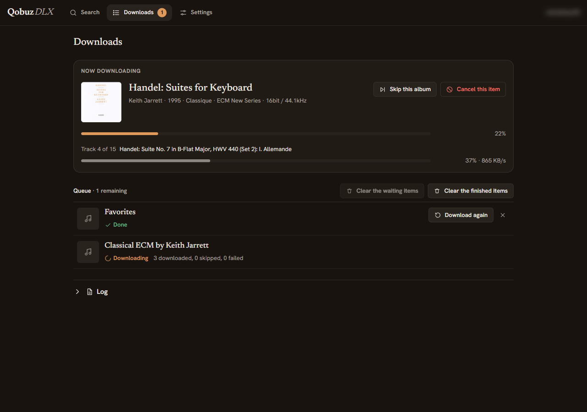
</p>

<p align="center">
  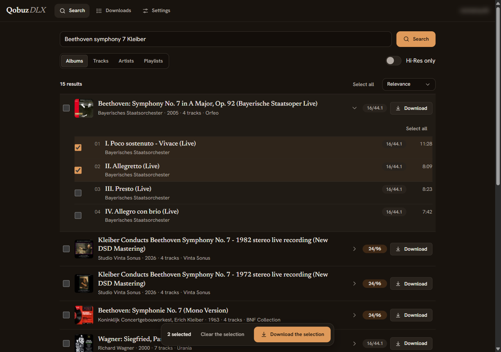
  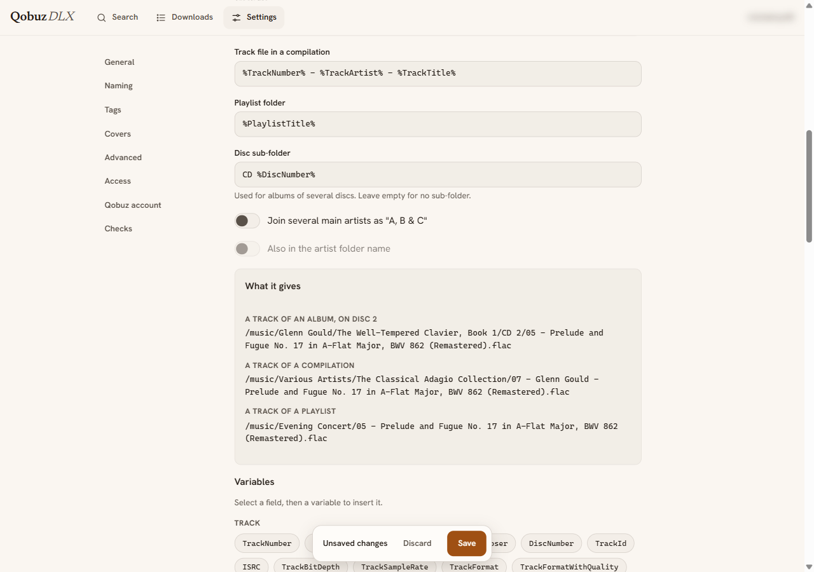
</p>
<p align="center">
  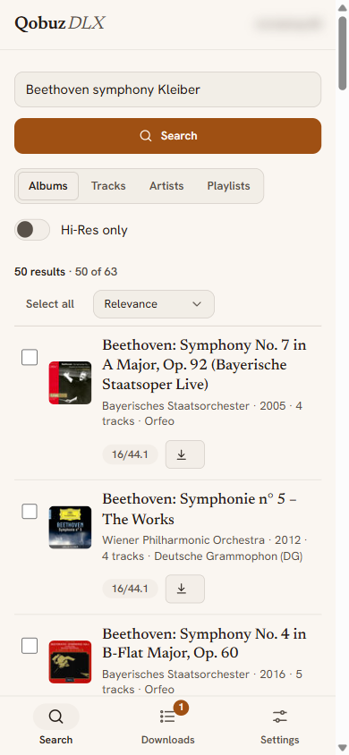
</p>

## Running it

### With Docker Compose

GitHub builds the image for x86 and ARM at every change and publishes it, so the server downloads it in a few seconds and compiles nothing.

```bash
git clone https://github.com/L-at-nnes/qobuzdlx.web.git
cd qobuzdlx.web
sudo docker compose pull
sudo docker compose up -d
```

Then open `http://<your server>:8080` and sign in to Qobuz. The settings, the session and the queue live in a Docker volume and survive an update. To update, `git pull`, then run the same two `docker compose` commands.

The image is `ghcr.io/l-at-nnes/qobuzdlx.web`. `latest` follows the main branch, a version tag gives `1.2.3` and `1.2`, and each build is also kept under its short commit hash. If `docker compose pull` is refused, the package is still private: on GitHub, open the package, then Package settings, then Change visibility, then Public (or run `docker login ghcr.io` on the server).

To build the image on the server from the source instead, run `sudo docker compose up -d --build`. The first time it compiles for 10 to 40 minutes depending on the machine.

To change anything, copy `.env.example` to `.env` and edit it (all of it is optional):

| Setting | Default | Meaning |
|---|---|---|
| `QOBUZDLX_IMAGE` | `ghcr.io/l-at-nnes/qobuzdlx.web:latest` | The image to run; a version pins it |
| `PORT` | `8080` | Port of the interface on the host |
| `ACCESS_PASSWORD` | none | Password of the interface, at least 8 characters |
| `DOWNLOADS_DIR` | `downloads` | A name keeps the music in a Docker volume; a path (`/srv/music`) puts it in that folder of the host |
| `COOKIE_SECURE` | `false` | `true` behind a reverse proxy that serves the interface over HTTPS |

The application runs as an unprivileged user (uid 65532): a folder of the host given as `DOWNLOADS_DIR` has to belong to it (`sudo chown -R 65532 /srv/music`).

### With plain Docker

```bash
docker run -d --name qobuzdlx \
  -p 8080:8080 \
  -v qobuzdlx-config:/config \
  -v /srv/music:/downloads \
  -e ACCESS_PASSWORD='a long password' \
  ghcr.io/l-at-nnes/qobuzdlx.web:latest
```

To build it yourself, run `docker build -t qobuzdlx .` and use `qobuzdlx` as the image name.

The variables of the application, which Compose fills in for you:

| Variable | Default | Meaning |
|---|---|---|
| `BIND` | `127.0.0.1:8080` (`0.0.0.0:8080` in the image) | Address the server listens on |
| `CONFIG_PATH` | `/config` | Where settings, session, queue and keys are kept |
| `DOWNLOADS_PATH` | `/downloads` | Download folder used until you choose another in the settings |
| `ACCESS_PASSWORD` | none | Password of the interface, at least 8 characters. When set, it cannot be changed from the interface |
| `COOKIE_SECURE` | `false` | Set to `true` when the interface is served over HTTPS, to mark the cookie `Secure` |
| `EXTENSIONS_PATH` | `<CONFIG_PATH>/extensions` | Where [extensions](#extensions) are looked for |

Without a password, anyone who can reach the server can use the Qobuz account linked to it. Set one if the server is reachable from anywhere but your own machine. Behind a reverse proxy, forward the `Host` header (or `X-Forwarded-Host`) so that the check of cross-site requests recognises your address.

### From source

You need Rust (1.85 or newer) and Node.js (22 or newer).

```bash
cd web && npm ci && npm run build && cd ..
cargo run --release
```

The interface is built into `web/build` and carried inside the executable; build it before `cargo build --release`. For work on the interface, `cd web && npm run dev` serves it with hot reload and proxies the API to a server on `127.0.0.1:8080`.

Checks:

```bash
cargo fmt --check && cargo clippy --all-targets && cargo test
cd web && npm run check && npm test
```

## Importing thousands of links

Import the file from the Downloads page. Every line is read first, then the valid links are queued in one step: either all of them are, or (if the request is cut) none. The queue then works through them one item at a time, in order, and saves itself to disk as it goes, so a restart, a sign-out or a pause never loses the list. At most 500 finished items are kept in the list; older ones are forgotten, their files stay.

**Qobuz publishes no rate limit, and none has been measured for this project.** What follows is advice drawn from how such services usually behave, not a guarantee: a very large queue downloaded flat out is the pattern most likely to be slowed down (HTTP 429) or looked at. The *Anti rate-limit* section of the settings gives three starting points that you can adjust:

| Profile | Before a track | Between albums | Long break, after any of | Break length | Tracks at once | After "too many requests" |
|---|---|---|---|---|---|---|
| Light (a few albums, the default) | 0.5 – 1.5 s | 3 – 8 s | 10 albums, 150 tracks, 3 GB | 2 – 5 min | 3 | 60 s |
| Careful (hundreds of links) | 1 – 4 s | 8 – 20 s | 6 albums, 100 tracks, 2 GB | 3 – 8 min | 2 | 120 s |
| Patient (thousands of links) | 2 – 6 s | 20 – 60 s | 4 albums, 60 tracks, 1 GB | 5 – 15 min | 1 | 300 s |

- The **long break** has three conditions, each of which can be switched off: tracks downloaded, albums downloaded, data downloaded (in megabytes, a megabyte being a million bytes). As soon as **any one** is reached since the last break, the queue rests for a length drawn between the two bounds you give in minutes, then the count starts again. A track already on the disk does not count, an album counts once it has written its first file, and the break comes between two albums, never in the middle of one, including between the albums of an artist or a label.
- Every wait is **drawn at random** between its two bounds, each time: a fixed pause is a pattern, a drawn one is not.
- A track already on the disk costs no wait, and an album that found everything in place only waits the shortest value: going through a list again is quick.
- When Qobuz answers 429 even after the client's own retries, the item is **not failed**: it goes back to its place, the queue waits the cooldown (doubled each time it happens again, up to 64 times, one hour at most) and tries again by itself. The Downloads page and the log say when.
- The number of tracks downloaded at once (Advanced) is the setting that most changes how many requests per minute Qobuz receives. For a long queue, use 1 or 2.
- A queue left to run overnight is gentler than the same queue run in a hurry. If you still meet 429, move to the next profile; if you never do, you can move back.
- Signing out, or a session that expires, pauses the queue without failing anything. Sign in again and it goes on. *Pause* in the Downloads page does the same by hand.

## A tour with a queue of 2,400 albums

Everything below is the real interface, filled with fake data: the account, the progress and the queue are simulated, nothing talks to Qobuz. The queue holds 2,400 albums built from the 141 real Qobuz links of classical music in [`docs/demo/classical-links.txt`](docs/demo/classical-links.txt), repeated in a shuffled order, with covers drawn from the title.

The list is a good one to try the import with: it mixes the spellings of a link (`play.qobuz.com`, `open.qobuz.com`, `www.qobuz.com` with its country and title), comments, blank lines, a YouTube and a Spotify link and a line that is not a link at all. 141 are kept, 10 lines are reported as ignored. A test (`the_demo_list_of_classical_albums_is_read_whole`) keeps that true.

### The queue

<p align="center">
  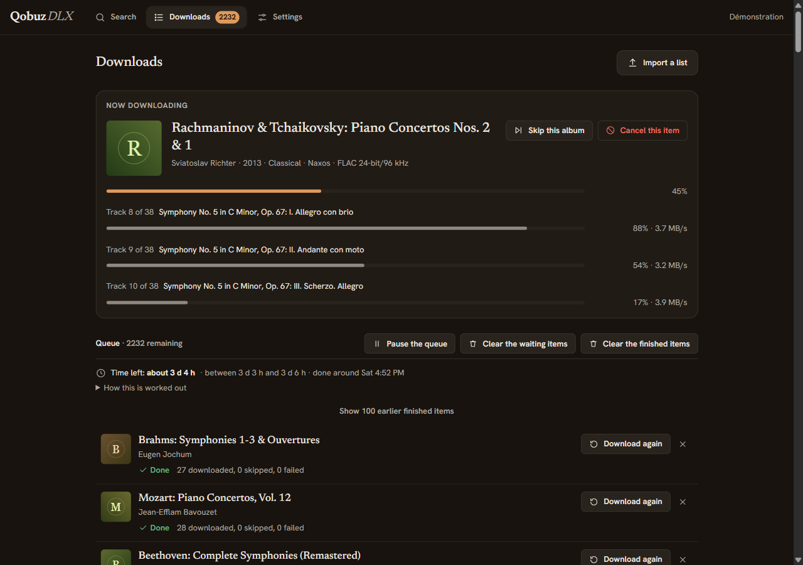
</p>

<p align="center">
  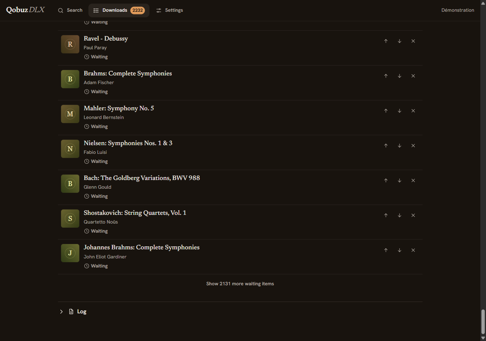
  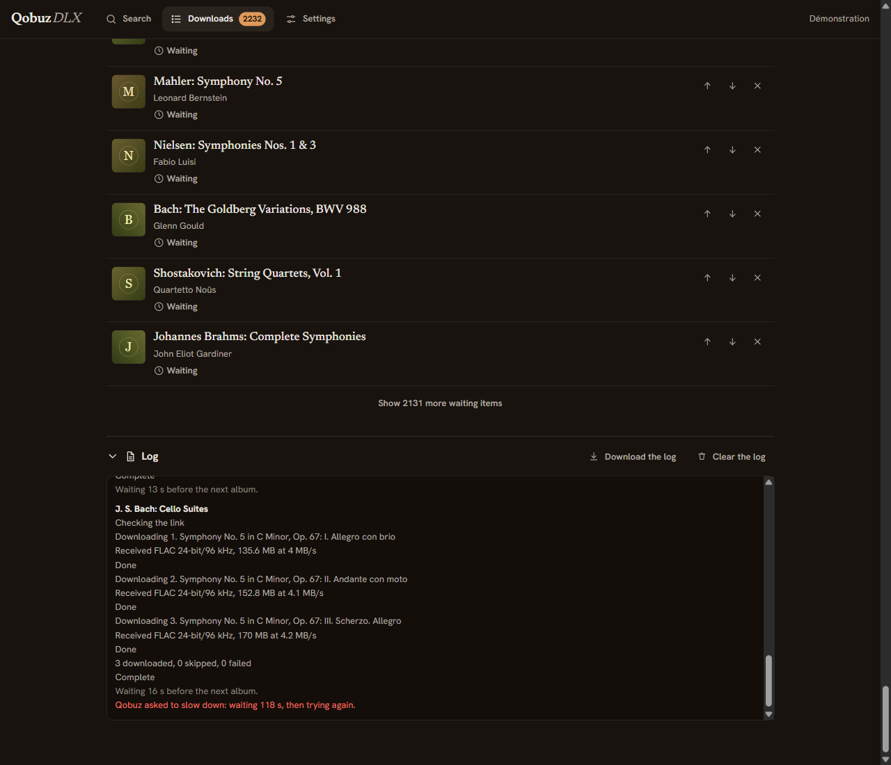
</p>

Only the first hundred waiting items are drawn, and the last twenty finished ones: a queue of thousands stays light, and a button shows more.

### Import

<p align="center">
  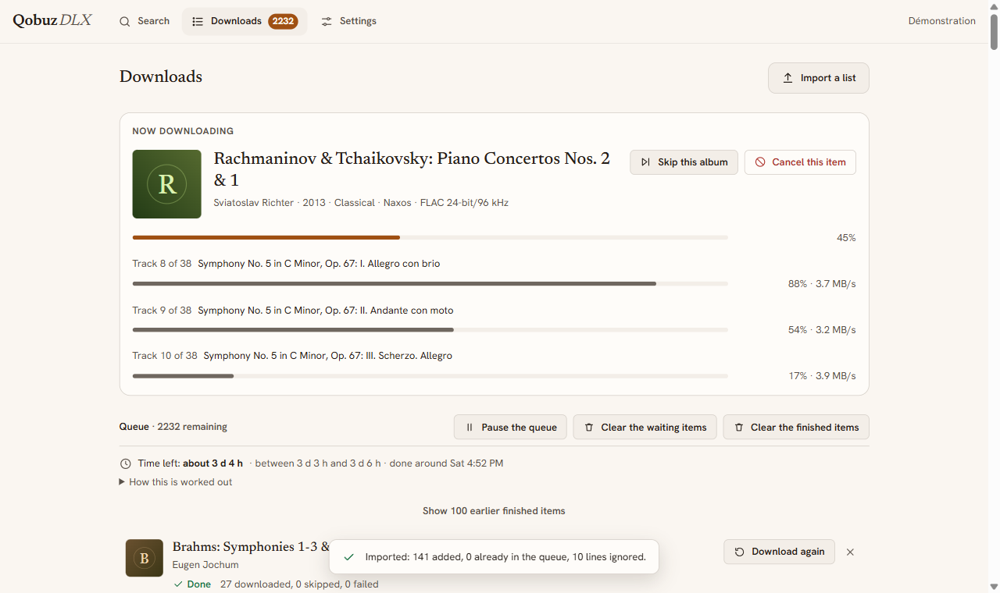
</p>

### Waits, breaks and pauses

<p align="center">
  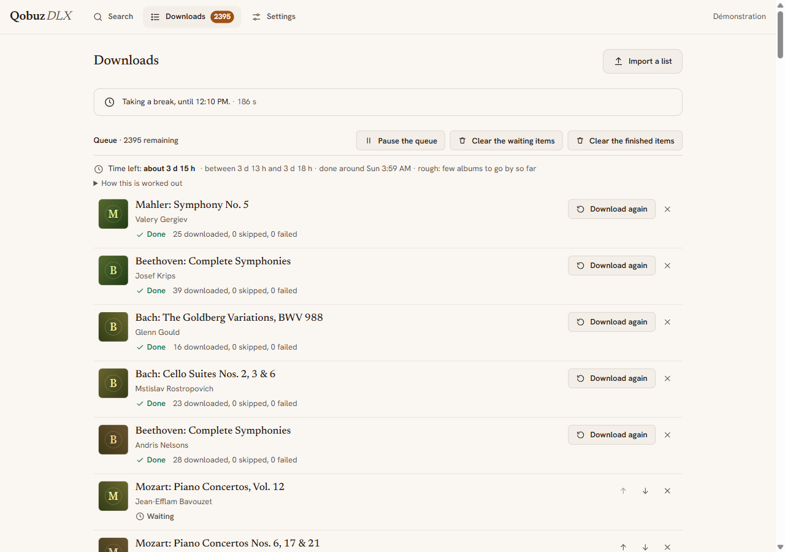
  
</p>

<p align="center">
  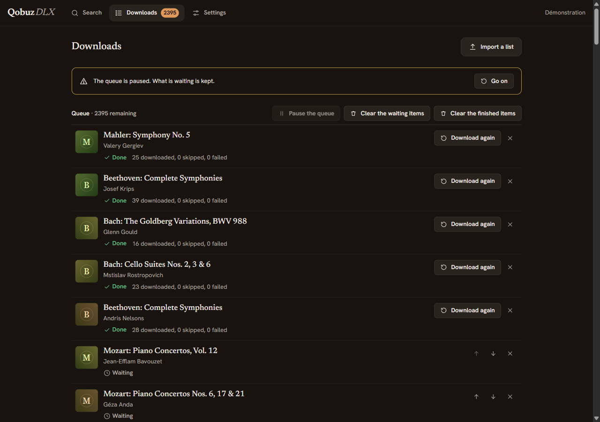
  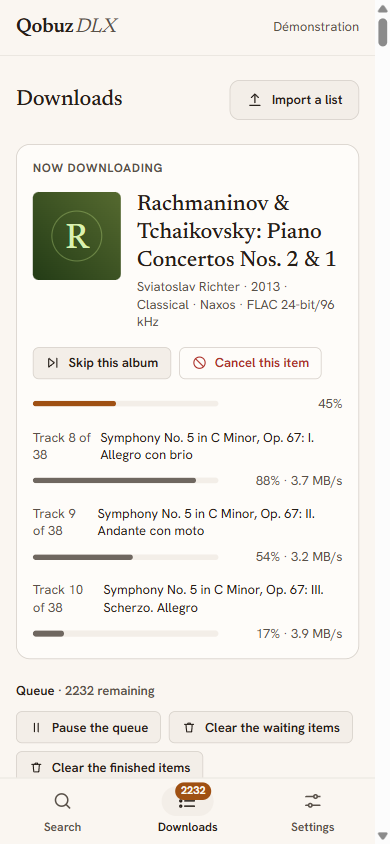
</p>

### The Anti rate-limit settings

<p align="center">
  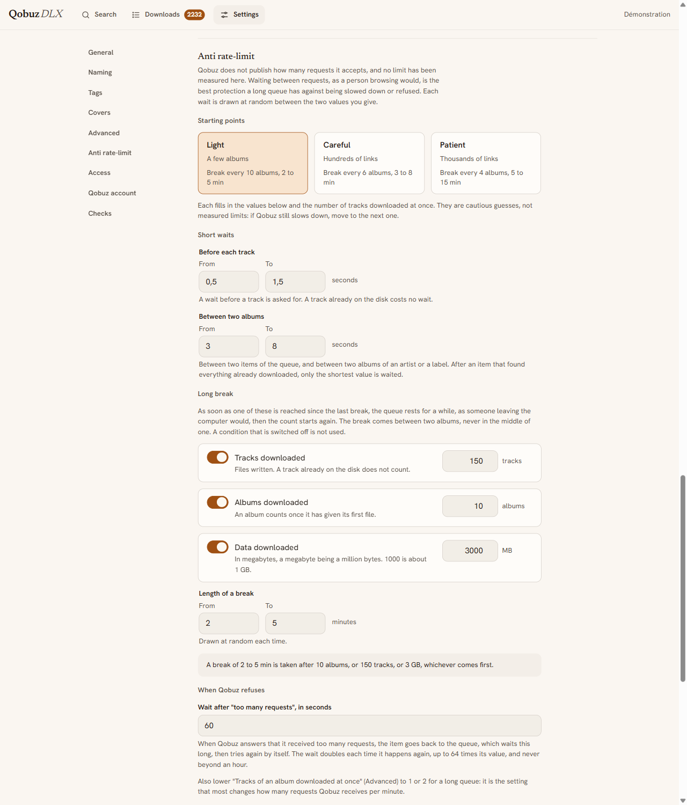
</p>

<p align="center">
  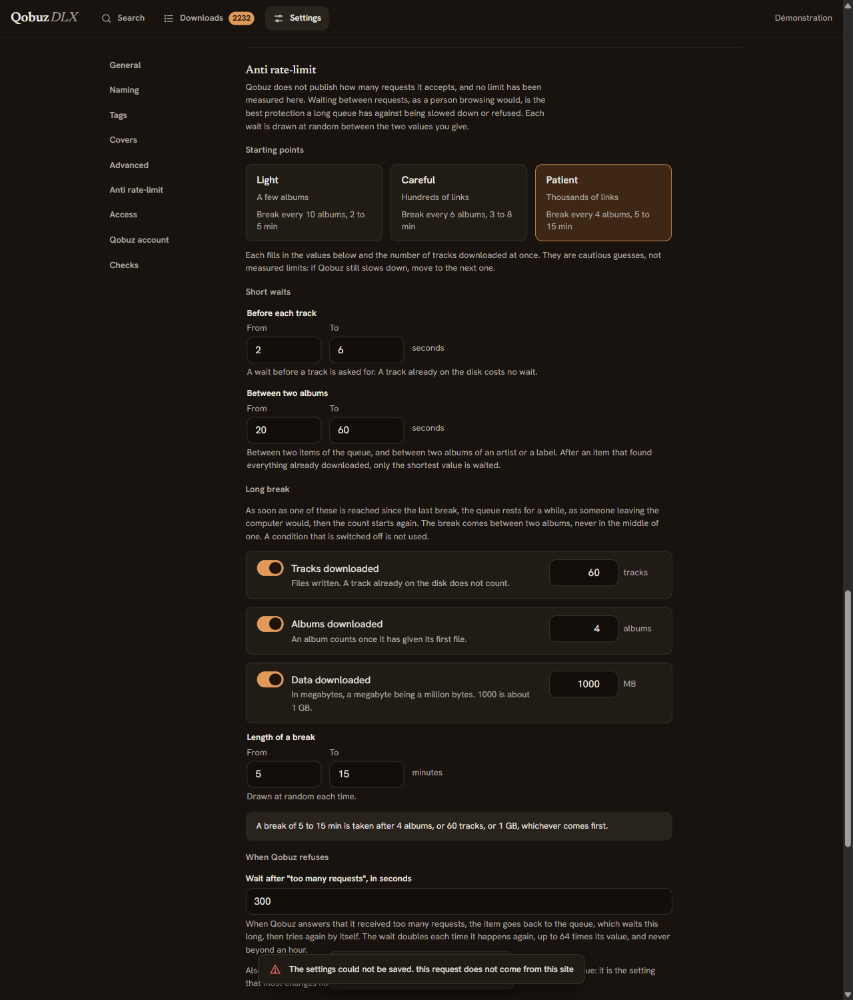
  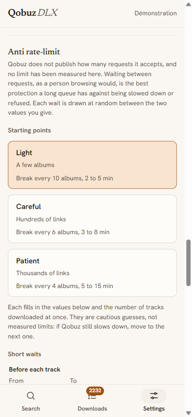
</p>

### Search

<p align="center">
  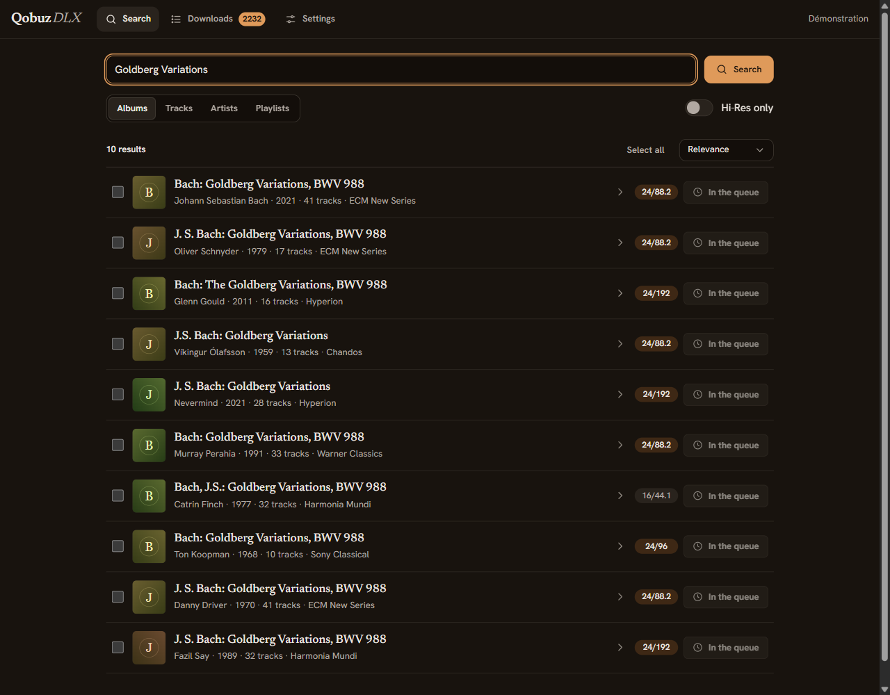
</p>

### Making these screenshots again

1. Start the server on another port than the usual one, with throwaway folders: `CONFIG_PATH=/tmp/demo/config DOWNLOADS_PATH=/tmp/demo/music BIND=127.0.0.1:8091 cargo run`.
2. Start the interface in development, in `web/`: `npm run dev`.
3. With Playwright, run [`docs/demo/mock-api.js`](docs/demo/mock-api.js) on a page (it answers the account, the catalogue, the queue and the log, and forwards the settings and the import to the server of step 1), then open `http://localhost:5173/downloads?scene=break`. The scene is one of `queue` (the default), `break`, `rate_limited`, `paused` or `empty`.

## Extensions

QobuzDLX tells **extensions** what it does, so that you can add your own actions after a download: move or convert files, rescan a media server, send a notification. They never get in the way of a download.

| Event | When |
|---|---|
| `track_saved` | A track is in its final place, tagged and verified |
| `item_finished` | An album, playlist, discography... ended, with its counts and the folders written |
| `queue_drained` | Nothing is left to download |

There are three kinds, and the first two are added without recompiling: a **command** (a program that gets the event as JSON on its standard input), a **webhook** (the event is `POST`ed to an address) and a **built-in** extension (Rust). To add one, put a folder with an `extension.json` into `<config>/extensions` (`/config/extensions` in the image) and restart:

```json
{
  "name": "notify",
  "events": ["item_finished"],
  "webhook": { "url": "http://my-service:9000/qobuzdlx" }
}
```

The container image has no shell, so in it a webhook is the easy way; see the guide for programs. The complete guide, with the manifest, every event, Docker, Rust, guarantees and troubleshooting, is in [docs/extensions.md](docs/extensions.md), and two examples are in [examples/extensions/](examples/extensions). `GET /api/extensions` lists what is loaded.

## How it is organised

| Path | What it holds |
|---|---|
| `src/qobuz/` | The Qobuz client: sign-in, app identifiers found in the web player, signed requests, retries, pagination |
| `src/download/` | The queue, the track pipeline (quality fallback, resuming, integrity check), jobs per kind of item, the manager |
| `src/naming/`, `src/tagging/` | Folder and file names from templates; tags and covers written with `lofty` |
| `src/extensions/` | The extension system: events, the manifest and loader, the command and webhook runners, the per-extension queues |
| `src/access/` | The password, the lock after wrong attempts, the signed cookie |
| `src/web/` | The HTTP API, the live events, and the interface served from the executable |
| `web/` | The interface (SvelteKit, built to static files) |
| `examples/extensions/` | Ready-to-copy extensions |
| `tests/` | Integration tests against a scripted fake of Qobuz and its CDN: no network, no account |

## Credits and license

Released under the [MIT license](LICENSE). Original project: [thimble9057/qobuzdlx.web](https://gitlab.com/thimble9057/qobuzdlx.web). The covers shown in the screenshots belong to their labels.
